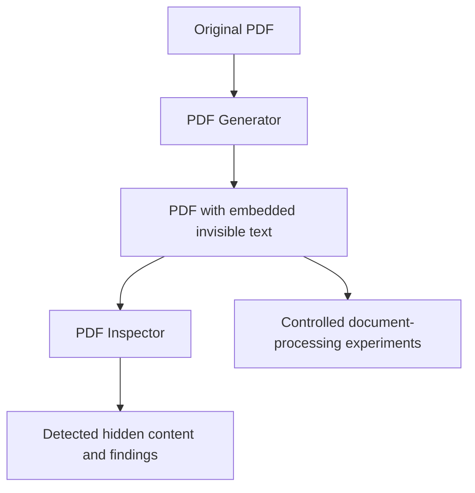

# InvisIA

### PDF Hidden Content Security Toolkit

**InvisIA** is a browser-based security research toolkit for generating and inspecting PDF documents containing text that is invisible in the normal document view but may still be available to text extractors, automated document processors, and AI-assisted workflows.

It was built to explore a simple security question:

> **What happens when a PDF contains information that a person cannot see, but software can still read?**

InvisIA combines two tools in a lightweight HTML, CSS, and JavaScript application. It is intended for security education, controlled demonstrations, and research into hidden document content.

## Features

| PDF Generator | PDF Inspector |
| --- | --- |
| Load an existing PDF document. | Load a PDF for analysis. |
| Embed text using PDF's invisible text-rendering mode. | Look for text rendered using the invisible text-rendering mode. |
| Preserve the document's visible appearance in typical viewers. | Display detected hidden content and analysis results. |
| Preview the document and download the modified PDF. | Preview the document alongside its findings. |
| Clear the current session and start again. | Clear the current session and inspect another file. |

The Generator and Inspector are separate pages, with a shared interface and distinct visual themes.

## How it works

PDF documents can contain text that is present in their internal structure without being painted visibly on the page. One example is **PDF text rendering mode 3** (`3 Tr`), which specifies invisible text.

InvisIA uses this behavior to demonstrate the gap between **what a human sees** and **what software may extract**.



### PDF Generator

1. Open **Generator** and select a PDF.
2. Enter the text you want to embed.
3. Click **Generate PDF**.
4. The application generates the modified file and requests a download. Use **Download PDF again** if you need another copy.

The embedded text is intended to remain invisible in an ordinary visual rendering of the PDF. It may still appear when the document is copied, parsed, or processed by other software. That is expected behavior, not an encryption mechanism.

### PDF Inspector

1. Open **Inspector** and select a PDF.
2. Click the inspection button.
3. Review the detection summary and any recovered hidden content.
4. Use **Clear** to reset the interface for another document.

The Inspector examines PDF content using PDF.js, including the page rendering operations associated with invisible text. It is **not** a general-purpose detector of every possible concealment or prompt-injection technique.

## Research example: AI-assisted document screening

One controlled proof of concept used two versions of a fictional résumé:

- **Original PDF:** The visible résumé described a candidate with experience unrelated to aerospace engineering.
- **Modified PDF:** The visible résumé looked the same, but invisible PDF text added fabricated aerospace-related qualifications and technical skills.

In an observed test with Gemini, a question about the candidate's suitability for an aerospace engineering role received a **negative answer** for the original document and a **positive answer** for the modified document.

This illustrates how hidden document content **can influence an AI-assisted assessment** under particular conditions. It does **not** establish that the effect is universal, reliably reproducible across models, or evidence that the AI executed a malicious instruction.

**Important distinction:** This example is better described as **data contamination / data poisoning** than as a demonstrated case of instruction-following prompt injection. InvisIA can also be used to study hidden instructions, but whether a specific system follows them must be tested separately.

**Internet access is required** for the current build to load third-party JavaScript libraries from their CDN sources.

## Technology

- **HTML5** for the application structure.
- **CSS3** for the responsive interface and tool-specific themes.
- **Vanilla JavaScript (ES Modules)** for the application logic.
- **[PDF-lib](https://pdf-lib.js.org/)** for editing PDFs and embedding invisible text.
- **[PDF.js](https://mozilla.github.io/pdf.js/)** for rendering PDFs and inspecting their internal text-rendering operations.

No application backend is required for normal use. PDF processing libraries are bundled locally with the application.

No application backend is required for normal use. PDF processing libraries are bundled locally with the application.

## Project structure

```text
InvisIA/
├── index.html
├── generator.html
├── inspector.html
├── css/
│   ├── styles.css
│   ├── generator.css
│   └── inspector.css
├── js/
│   ├── generator.js
│   ├── inspector.js
│   ├── pdf-engine.js
│   └── pdf-preview.js
├── lib/
│   ├── pdf-lib.min.js
│   ├── pdf.mjs
│   ├── pdf.worker.mjs
│   ├── LICENSE.md
│   └── LICENSE
├── README.md
└── LICENSE
```

## Privacy and processing

InvisIA is designed to process selected PDFs **in the browser**, without an application server receiving the documents for generation or inspection.

However, the page **does request JavaScript dependencies from third-party CDNs**. Browser extensions, hosting configuration, and third-party resources can also affect network behavior. If you are evaluating privacy or handling sensitive documents, inspect the browser's Network panel and review the deployed source code before use.

**Do not upload confidential documents to an untrusted deployment.**

## Known limitations

- **Detection scope:** The Inspector focuses on invisible PDF text-rendering behavior. It does not comprehensively detect white-on-white text, off-page objects, clipping-based hiding, transparent overlays, hidden layers, metadata, attachments, or every other form of concealed content.
- **Parsing differences:** PDF viewers, text extractors, OCR tools, and AI document processors do not necessarily interpret the same file in the same way.
- **Document compatibility:** Encrypted, malformed, unusual, or otherwise unsupported PDFs may fail to load or behave differently.
- **Text encoding:** Some characters or writing systems may not be supported by the Generator's current PDF text-embedding approach.
- **Visual previews:** The application preview is a convenience, not a substitute for independent verification with another PDF viewer.
- **AI behavior:** Hidden content does not guarantee that any particular model or document-processing system will read, trust, or follow it.
- **Network dependency:** CDN-hosted libraries require an internet connection in the current build.

A clean result from the Inspector means **no supported hidden-text pattern was found by this analysis**, not that the PDF is free from all hidden content or security risks.

## Suggested validation workflow

For reproducible security research:

1. Keep a copy of the original PDF.
2. Generate a modified version with a known, non-sensitive test string.
3. Compare the visible output in an independent PDF viewer.
4. Analyze both PDFs with the Inspector.
5. Compare text extraction results and, if relevant, the behavior of a document-processing or AI system.
6. Record the file versions, tools, model, prompts, and observations, including negative results.

Only perform tests on documents and systems you own or are authorized to assess.

## Responsible use

InvisIA is provided for **education, defensive testing, and authorized security research**. It should not be used to misrepresent qualifications, manipulate real hiring decisions, or interfere with systems without permission.

The existence of hidden text is not, by itself, proof of malicious intent. Findings require context and manual review.

## License

See [LICENSE](LICENSE) for the repository's licensing terms.
